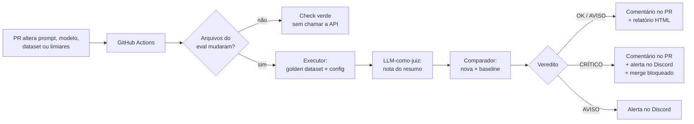

# Senderix Eval

**CI de qualidade para o classificador com LLM do [Senderix](https://senderix.com.br).** A cada mudança de prompt ou de modelo, este repositório aplica um golden dataset ao classificador, pontua o resultado em cinco dimensões (acerto de categoria, conformidade de formato, qualidade do resumo, latência e custo), compara com a versão aprovada em produção e, se a qualidade cair além dos limiares, **bloqueia o merge**, comenta no PR e alerta o time no Discord. O objetivo é simples: nenhuma mudança no comportamento da IA chega aos clientes sem ter sido medida.

> Este documento é o ponto de partida para quem entra no time. Ele explica o que o sistema faz, por que foi construído assim e como operá-lo no dia a dia.

---

## Sumário

1. [Contexto: onde este eval se encaixa no Senderix](#1-contexto-onde-este-eval-se-encaixa-no-senderix)
2. [Como funciona](#2-como-funciona)
3. [Estrutura do repositório](#3-estrutura-do-repositório)
4. [Setup local](#4-setup-local)
5. [Operação do dia a dia](#5-operação-do-dia-a-dia)
6. [O eval no CI](#6-o-eval-no-ci)
7. [Golden dataset: como adicionar casos](#7-golden-dataset-como-adicionar-casos)
8. [Limiares: como ajustar](#8-limiares-como-ajustar)
9. [Decisões de arquitetura](#9-decisões-de-arquitetura)
10. [Resultados: a escolha do modelo de produção](#10-resultados-a-escolha-do-modelo-de-produção)
11. [Limitações conhecidas](#11-limitações-conhecidas)

---

## 1. Contexto: onde este eval se encaixa no Senderix

O **Senderix** é um SaaS de automação de campanhas no WhatsApp, usado por imobiliárias, clínicas, salões e barbearias, infoprodutores e operações de cobrança. Depois de cada disparo, os contatos respondem, e essas respostas precisam ser triadas rapidamente: um lead interessado esfria em horas, e um pedido de descadastro ignorado vira denúncia.

Para isso, um **classificador com LLM** lê cada resposta e devolve:

| Campo | Valores | Para que serve |
|---|---|---|
| `categoria` | `interessado`, `duvida`, `opt_out`, `reclamacao`, `fora_de_contexto` | Decide o que acontece com o contato |
| `resumo` | uma frase em português | Permite ao atendente entender a mensagem num relance |

A categoria é a parte que **move o sistema**:

- **Kanban de atendimento:** cada categoria leva o contato a uma coluna do funil. `interessado` vira lead; `reclamacao` vira prioridade de atendimento.
- **Opt-out automático:** `opt_out` tira o contato das próximas campanhas.
- **Bloco de resposta por IA:** o mesmo tipo de chamada a LLM sustenta o bloco de chatbot nos fluxos de automação, em que a resposta precisa chegar ao WhatsApp em segundos.

Por isso, um erro de classificação tem custo real e assimétrico:

- **Falso opt-out:** um cliente interessado sai da base e nunca mais recebe ofertas.
- **Opt-out perdido:** o contato que pediu para parar continua recebendo mensagens, e o risco de **denúncia e banimento do número pela Meta** sobe.
- **Lead classificado como dúvida:** a oportunidade cai na coluna errada do kanban e esfria.

E o classificador muda com frequência: prompts são refinados, modelos são aposentados pelos provedores (dois dos modelos testados aqui foram descontinuados durante o desenvolvimento) e a escolha do modelo é uma troca contínua entre **qualidade, custo e latência**. Este eval existe para que essas mudanças sejam decisões medidas, e não apostas.

---

## 2. Como funciona



Em uma frase por componente:

| Etapa | O que faz |
|---|---|
| **Classificador** | Envia a mensagem ao modelo via OpenRouter e valida a resposta contra um contrato Pydantic. |
| **Executor** | Roda todos os casos do golden dataset e registra, por caso, acerto, formato, latência, tokens e custo. |
| **Juiz** | Um modelo mais forte e fixo dá nota de 1 a 5 ao resumo, comparando com o resumo de referência. |
| **Comparador** | Compara a execução nova com a baseline aprovada: regressões, melhorias e acurácia por categoria. |
| **Limiares** | Transformam a comparação em veredito: `ok`, `aviso` ou `critico`. |
| **Relatório** | Página HTML autocontida com KPIs, gráficos e as tabelas de regressões e melhorias. |
| **Alertas** | Card no Discord em aviso ou crítico. |
| **Drift** | Acompanha a média móvel das execuções e detecta quedas graduais que nenhuma comparação isolada pega. |
| **CI** | Orquestra tudo a cada PR e usa o código de saída para bloquear o merge. |

---

## 3. Estrutura do repositório

```
senderix-eval/
├── config_producao.yaml     # o que está em produção: prompt, modelo e dataset
├── limiares.yaml            # limiares do veredito e do drift
├── prompts/                 # prompts versionados (v1…v6) e o prompt do juiz (juiz_v1)
├── dataset/                 # golden datasets versionados (golden_v1, golden_v2)
├── baseline/execucao.json   # execução aprovada: a referência de toda comparação no CI
├── resultados/              # histórico de execuções reais (alimenta o drift)
├── templates/               # template Jinja2 do relatório HTML
│
├── contratos.py             # todos os contratos Pydantic do sistema
├── classificador.py         # chamada ao modelo, extração e validação da resposta
├── juiz.py                  # LLM-como-juiz da qualidade do resumo
├── executor.py              # aplica o golden dataset e salva a execução
├── comparador.py            # compara duas execuções e dá o veredito
├── relatorio.py             # gera o relatório HTML
├── alertas.py               # alertas no Discord (regressão e drift)
├── drift.py                 # detecção de drift lento por média móvel
├── simular_historico.py     # gera históricos sintéticos para testar o drift
├── eval_ci.py               # ponto de entrada do pipeline de CI
├── promover_baseline.py     # promove uma execução a nova baseline
│
├── .github/workflows/eval.yml
├── Dockerfile
└── requirements.txt
```

Pastas geradas e **não versionadas**: `relatorios/`, `saida_ci/` e `resultados_simulados/`.

---

## 4. Setup local

**Requisitos:** Python 3.11 e uma chave do [OpenRouter](https://openrouter.ai). O Docker é opcional.

```bash
git clone https://github.com/pedroatilagc/senderix-eval.git
cd senderix-eval
python -m venv .venv
.venv\Scripts\activate          # Windows
# source .venv/bin/activate     # Linux / macOS
pip install -r requirements.txt
```

Crie um `.env` na raiz:

```
OPENROUTER_API_KEY=sk-or-...
DISCORD_WEBHOOK_URL=https://discord.com/api/webhooks/...   # opcional
```

Sem o `DISCORD_WEBHOOK_URL`, tudo funciona normalmente; os alertas são apenas pulados com um aviso no terminal. O `.env` está no `.gitignore` e **nunca deve ser versionado**.

### Com Docker

```bash
docker build -t senderix-eval .
docker run --rm --env-file .env -v "${PWD}/saida_ci:/app/saida_ci" senderix-eval --alertar
```

O volume (`-v`) traz o relatório, o JSON da execução e o resumo para a pasta `saida_ci/` da máquina. Os segredos entram apenas em tempo de execução e nunca ficam na imagem.

---

## 5. Operação do dia a dia

### Rodar o pipeline completo, como no CI

```bash
python eval_ci.py              # avalia a config de produção contra a baseline
python eval_ci.py --alertar    # idem, enviando alerta ao Discord em aviso/crítico
```

Custo de uma execução completa com o juiz: cerca de **US$ 0,03**.

### Comparar duas execuções quaisquer

```bash
python comparador.py resultados/<base>.json resultados/<nova>.json [--alertar]
```

A **base** é sempre o que está em produção hoje; a **nova** é a candidata. Inverter a ordem inverte a pergunta.

### Gerar só o relatório HTML

```bash
python relatorio.py resultados/<base>.json resultados/<nova>.json
```

### Verificar drift

```bash
python drift.py --modelo google/gemini-2.5-flash --prompt v5 --dataset v2 [--alertar]
```

O drift precisa de pelo menos 6 execuções da mesma configuração. Para testá-lo sem histórico real:

```bash
python simular_historico.py resultados/<uma_execucao_real>.json
python drift.py --modelo google/gemini-2.5-flash --prompt v5 --dataset v2 --pasta resultados_simulados/queda_lenta
```

O cenário `queda_lenta` foi desenhado para que **todos os pares consecutivos passem no comparador** e, ainda assim, o drift acuse a queda acumulada. Dados simulados nunca são gravados em `resultados/`.

### Testar o caminho crítico sem gastar API

```bash
python eval_ci.py --execucao-nova resultados/<execucao_ruim>.json
```

Usa uma execução já salva como "nova", pulando as chamadas ao modelo.

### Códigos de saída

| Código | Significado | Bloqueia o merge? |
|---|---|---|
| `0` | OK ou aviso | Não |
| `1` | Uso incorreto, baseline ausente ou de outro dataset | Sim |
| `2` | Regressão crítica | Sim |
| `3` | Erro de infraestrutura (API fora do ar, chave inválida) | Sim |

O `drift.py` sempre sai com `0`: ele indica uma tendência, não uma mudança específica a ser revertida.

---

## 6. O eval no CI

### O que dispara

O workflow roda em **todo PR para a `main`** e no disparo manual (`workflow_dispatch`). Um passo inicial verifica se algum arquivo relevante mudou (`prompts/`, `dataset/`, `baseline/`, `templates/`, `config_producao.yaml`, `limiares.yaml`, `requirements.txt`, o próprio workflow ou os `.py` da raiz). Se nada mudou, o check termina verde em segundos, sem custo de API. Isso permite que o check seja **obrigatório** na proteção da `main` sem travar PRs que não tocam no eval.

### Como ler o resultado

- **Comentário no PR:** veredito, tabela de métricas base × nova, motivos e regressões. A cada push, o bot **atualiza** o mesmo comentário.
- **Artefatos da execução:** relatório HTML, JSON da execução e o resumo. Ficam no link *Execução do workflow* do comentário.
- **Discord:** card amarelo (aviso) ou vermelho (crítico).

Os horários das execuções feitas no CI estão em **UTC**.

### O que bloqueia o merge

A `main` é protegida por um ruleset que exige o check **Senderix Eval**. Qualquer código de saída diferente de `0` falha o check e bloqueia o merge. **Aviso não bloqueia**: ele pede um olhar humano.

### Segredos

`OPENROUTER_API_KEY` e `DISCORD_WEBHOOK_URL` ficam em **GitHub Secrets** e nunca aparecem em logs, artefatos ou comentários. PRs vindos de forks não recebem secrets; nesse caso, o eval é pulado com uma mensagem explicativa e o PR precisa de avaliação manual.

### Fluxo de uma mudança em produção

1. Crie uma branch e altere o prompt (nova versão em `prompts/`) ou o modelo em `config_producao.yaml`.
2. Abra o PR. O eval roda e comenta.
3. Se o veredito for aceitável, baixe o JSON da execução nos artefatos e promova-o a baseline:
   ```bash
   python promover_baseline.py <execucao.json>
   ```
   O script recusa execuções cuja configuração não bate com `config_producao.yaml`.
4. Inclua a baseline nova no mesmo PR e faça o merge.

A promoção é **manual por decisão de projeto**: o CI nunca escreve na baseline nem faz commits.

---

## 7. Golden dataset: como adicionar casos

O golden dataset é o gabarito do eval. Cada caso tem este formato:

```json
{
  "id": "caso-031",
  "mensagem": "vou pensar e te falo",
  "categoria_esperada": "interessado",
  "resumo_ideal": "diz que vai pensar e responder depois",
  "dificuldade": "dificil",
  "notas": "lead morno: não recusou a oferta. decisão: interessado, para não sair do funil"
}
```

O arquivo é validado pelo Pydantic ao ser carregado: uma categoria digitada errado ou uma dificuldade fora de `facil` / `media` / `dificil` impede a execução e aponta o caso exato.

### Regras

1. **Escreva à mão, nunca com um LLM.** O gabarito é a verdade de referência; gerado por modelo, ele herdaria os vícios do que deveria avaliar.
2. **A categoria é uma decisão de negócio.** Pergunte *"o que o Senderix deve fazer com este contato?"*, e não *"o que o modelo provavelmente responde?"*. Registre a decisão em `notas` sempre que o caso não for óbvio.
3. **`resumo_ideal` resume a mensagem**, não descreve a categoria. Ele é a referência do juiz.
4. **IDs são estáveis e nunca reaproveitados.** O comparador casa execuções pelo ID; reaproveitar um ID quebra a comparação histórica.
5. **Cubra os casos difíceis de propósito:** ironia, caixa alta, mensagens de uma palavra, só emoji ou figurinha, menções a pagamento que são reclamações, e os cinco segmentos de clientes.
6. **Anonimize.** Mensagens inspiradas em conversas reais não podem conter nomes, telefones ou qualquer dado que identifique a pessoa (LGPD).

### Quando criar uma nova versão do dataset

- Mudanças em `notas` ou `dificuldade` não alteram o que é medido e podem ser feitas no arquivo atual.
- **Mudar uma `categoria_esperada`, adicionar ou remover casos altera a régua.** Crie `golden_vN+1.json`, aponte `config_producao.yaml` para ele e gere uma baseline nova com `python eval_ci.py --apenas-executar`. Execuções de datasets diferentes nunca são comparadas: o comparador recusa.

### O holdout e a regra mais importante

O `golden_v1` foi usado para ajustar os prompts da v2 à v5. O `golden_v2` foi escrito depois, com mensagens inéditas, para medir se as regras **generalizam**. **Nunca ajuste o prompt olhando para os erros de um conjunto que você usa para medir generalização.** No momento em que isso acontece, o conjunto vira mais uma lista de exercícios, e um novo conjunto inédito passa a ser necessário.

---

## 8. Limiares: como ajustar

```yaml
queda_aviso_pp: 5.0             # queda da taxa de acerto que gera aviso
queda_critico_pp: 10.0          # queda que gera crítico (bloqueia o merge)
queda_nota_resumo_aviso: 0.3    # queda da nota média do resumo que gera aviso
categorias_criticas:
  - opt_out                     # qualquer regressão aqui gera aviso
drift:
  janela: 5                     # tamanho da média móvel
  min_execucoes: 6              # abaixo disso: histórico insuficiente
  queda_taxa_pp: 5.0
  queda_nota_resumo: 0.3
```

**Como os valores foram escolhidos.** Com 30 casos, **cada caso vale 3,3 pp**. Medimos que a mesma configuração, sem nenhuma mudança, oscila um caso entre execuções. Por isso:

- **1 caso (3,3 pp)** é tratado como ruído e não alerta;
- **2 casos (6,7 pp)** geram aviso;
- **3 casos (10 pp)** geram crítico.

Os 3% / 8% sugeridos em referências de mercado pressupõem datasets maiores e, aqui, gerariam falsos alertas constantes.

**Ao mudar o tamanho do dataset, recalibre.** A regra prática é manter o aviso acima do valor de um caso e o crítico em torno de três casos. Para categorias críticas, o custo do erro justifica alertar mesmo em um único caso.

---

## 9. Decisões de arquitetura

| Decisão | Justificativa |
|---|---|
| **Prompts versionados em YAML, imutáveis** | Comparar duas versões exige que as duas existam. Cada versão muda uma coisa só e registra o motivo em `descricao`, como uma mensagem de commit. |
| **Contratos Pydantic em todas as fronteiras** | A saída do LLM é tratada como dado externo não confiável. Categoria inventada, campo faltando ou JSON quebrado são detectados na fronteira, antes de chegar ao kanban. O mesmo vale para o dataset, a configuração e os limiares. |
| **OpenRouter como camada de acesso aos modelos** | Trocar de modelo é mudar uma string. Isso viabiliza comparar provedores e reagir a modelos aposentados sem reescrever código. O custo real de cada chamada vem na própria resposta. |
| **`temperature=0` e exemplo one-shot no prompt** | Reduzem a variação entre execuções e as falhas de formato. Na v3, o exemplo completo de resposta eliminou as respostas vazias e truncadas de um dos modelos. |
| **Extração tolerante do JSON** | Alguns modelos embrulham o JSON em blocos de markdown. Recortar o objeto antes de validar resolve o embrulho sem relaxar a validação dos dados. |
| **Formato e acurácia medidos separadamente** | Uma taxa única mistura dois problemas com soluções diferentes: robustez de formato e regras de classificação. |
| **Falhas de formato registradas, falhas de infraestrutura interrompem** | Formato inválido é um resultado do modelo e entra na métrica. Erro de rede ou chave inválida tornaria toda a execução não confiável, então o eval para. |
| **Custo e latência medidos mesmo quando o formato falha** | Uma resposta inválida também foi paga e esperada. |
| **LLM-como-juiz com rubrica, juiz fixo e mais forte** | O resumo não é comparável por igualdade de texto. Rubrica explícita, justificativa antes da nota e `temperature=0` tornam as notas consistentes; um juiz único e mais forte torna as notas comparáveis entre modelos. O custo do juiz é contabilizado à parte do custo do classificador. |
| **Limiares calibrados ao tamanho do dataset** | Ver a seção 8. |
| **`opt_out` como categoria crítica** | O erro de opt-out tem consequência regulatória e comercial (banimento do número), e justifica alerta em um único caso. |
| **Drift por média móvel** | Pega quedas graduais em que cada passo fica abaixo dos limiares. Comprovado com histórico sintético: 9 de 9 pares consecutivos OK no comparador, queda acumulada de 8 pp detectada pelo drift. |
| **Baseline versionada, promoção manual** | A referência de comparação fica no repositório e muda só por decisão humana, revisada no PR. Rodar o eval também na `main` a cada PR dobraria o custo. |
| **Códigos de saída como contrato com o CI** | `2` (crítico) e `1` (uso) nunca colidem; por isso o `comparador.py` não usa `argparse`, que sai com `2` em erro de uso. Falhas no alerta ou no relatório nunca mudam o código de saída. |
| **Detecção de mudanças dentro do job, em vez de filtro de caminhos no gatilho** | Com filtro no gatilho, um check obrigatório ficaria pendente para sempre em PRs que não tocam o eval. |
| **Relatório HTML autocontido, gráficos em SVG** | Um único arquivo, sem dependências, que funciona offline e como artefato do CI. |

---

## 10. Resultados: a escolha do modelo de produção

O próprio eval foi usado para escolher o modelo do Senderix. Configuração: **prompt v5, golden v2 (30 casos inéditos), juiz `openai/gpt-4.1`**.

| Modelo | Acurácia | Formato válido | Nota do resumo | Latência P50 | Latência P95 | Custo / 10 mil msgs |
|---|---|---|---|---|---|---|
| **google/gemini-2.5-flash** | **96,7%** | 100% | 3,93 | **1,0 s** | **1,2 s** | US$ 1,94 |
| anthropic/claude-haiku-4.5 | 90,0% | 100% | 4,27 | 1,3 s | 2,4 s | US$ 7,51 |
| deepseek/deepseek-v4-flash | 86,7% | 100% | **4,60** | 2,6 s | 5,6 s | **US$ 0,36** |
| openai/gpt-4o-mini | 86,7% | 100% | 4,00 | 1,5 s | 2,7 s | US$ 0,78 |

**Decisão: Gemini 2.5 Flash.** Para responder no WhatsApp, o que mais pesa é a combinação de **acerto de categoria, latência previsível e custo**, e o Gemini lidera nas duas primeiras com custo baixo em valor absoluto. Em especial:

- foi o que **menos errou opt-out**, a categoria de maior risco;
- teve a latência mais **estável** (P95 de 1,2 s), essencial para uma resposta em tempo real no WhatsApp e para o bloco de resposta por IA;
- a vantagem se repetiu no golden v1, no holdout e na rodada com o juiz.

**Os trade-offs considerados:**

- O **DeepSeek** escreve os melhores resumos e é 5 vezes mais barato, mas gera em média ~200 tokens de raciocínio por resposta, com picos de **15 s** para classificar uma única mensagem. É uma boa opção apenas para processamento em lote, sem exigência de tempo real.
- O **Haiku** é rápido no caso típico, mas custa 4 vezes o Gemini e acerta menos.
- O **GPT-4o-mini** é barato, mas erra sistematicamente inferências implícitas (pagamento, convênio, intenção).
- O ponto fraco do Gemini são resumos mais curtos, que omitem datas e horários. Uma regra de prompt pedindo para preservá-los é o próximo ajuste natural.

### Evolução do prompt

| Versão | Mudança | Motivo |
|---|---|---|
| v1 | Definições das categorias e regra de desempate opt-out × reclamação | Linha de base |
| v2 | Perguntas de preço e pagamento → `interessado` | Perguntas de compra eram classificadas como dúvida |
| v3 | Idioma do resumo fixado e exemplo one-shot (só formato) | Respostas vazias, truncadas e em outro idioma em um dos modelos |
| v4 | Critério geral de intenção; opt-out inclui desinteresse e irritação com repetição; regras de proteção | Erros comuns aos 4 modelos: falta de regra, não limitação de modelo |
| v5 | Horário de funcionamento (`duvida`) × horário livre para agendar (`interessado`) | Regressão introduzida pela v4 |

Regra usada em todo o processo: **quando todos os modelos erram o mesmo caso, falta instrução no prompt; quando só um erra, é limitação do modelo.**

### Validação em produção

Um PR de teste trocando o modelo de produção de Gemini para GPT-4o-mini resultou em **veredito CRÍTICO** (−10 pp de acurácia e regressão em `opt_out`), alerta no Discord e **merge bloqueado** pela proteção da `main`, sem nenhuma intervenção manual.

---

## 11. Limitações conhecidas

- **Dataset pequeno.** Com 30 casos, cada caso vale 3,3 pp e a fronteira entre sinal e ruído é estreita. Os limiares compensam isso de forma pragmática, não estatística. O caminho é crescer o dataset e rodar cada configuração mais de uma vez.
- **Não determinismo.** Mesmo com `temperature=0`, a mesma configuração varia um caso entre execuções. O caso de opt-out mais ambíguo (*"como você pegou meu número?"*) chega a gerar avisos falsos. A melhoria planejada é **confirmar regressões** reexecutando só os casos que regrediram antes de alertar.
- **Viés possível do juiz.** O juiz é da família OpenAI; não houve sinal de autopreferência nos resultados, mas o risco existe e deve ser considerado ao ler as notas.
- **Juiz custa mais que o classificador.** Cerca de US$ 0,027 por execução, de 5 a 25 vezes o custo do classificador avaliado.
- **Drift pouco sensível com histórico curto.** Com 6 execuções e janela de 5, as médias compartilham 4 execuções. A detecção ganha força conforme o histórico cresce.
- **Alertas apontam para o caminho local do relatório.** No CI, o relatório deve ser baixado pelos artefatos do workflow.
- **PRs de forks não recebem secrets** e precisam de avaliação manual.
